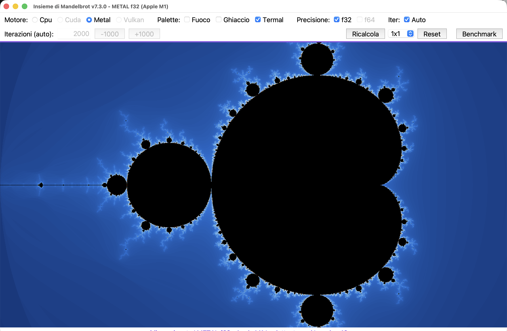

# MandelF (macOS Python side)

Thin env over `../generic-python/source/` (package `mandelbrot`, entry
`mandel.py`) — no code duplication. Tkinter + CPU/Metal(/CUDA/Vulkan) engines.



## Run (dev)

```sh
python3 ../generic-python/source/mandel.py
```

Deps: tkinter (stdlib), numpy, numba, Pillow; Metal via pyobjc.
See `../generic-python/AGENTS.md` and `macos-python/AGENTS.md`.

## Publish

Built with `../generic-python/packaging/build_app.py`
(PyInstaller one-dir, `.app` + DMG with /Applications symlink).
Deliverable: `dist/MandelF-python-X.Y.Z-arm64.dmg` (keep the last 2).
