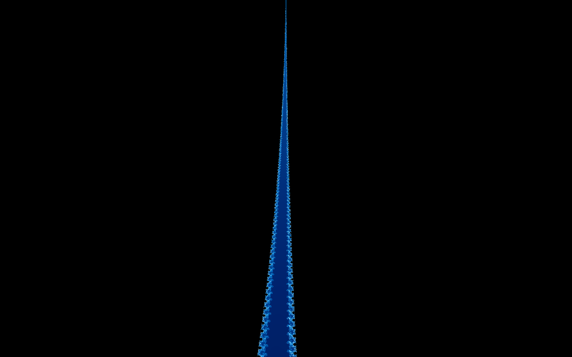

# MandelSwift (macOS SwiftUI port)

Native SwiftUI port of the Mandelbrot viewer: Swift 6, macOS 14+, Apple Silicon.
Implements the shared contracts in `../AGENTS.md` (§1–§8): CPU engine
(4 SIMD paths, LUT, SSAA, tiles, Julia), Metal GPU engine (float, §4.1),
history, zones/favorites, settings, export, benchmark+CSV, zoom video,
back-to-set, log, about, headless CLI.





## Build / run / test (.NET not needed)

```sh
export SCRATCH="$TMPDIR/mandel-swift-build"   # .build on SSD: repo lives on NAS
swift build --scratch-path "$SCRATCH"
swift run --scratch-path "$SCRATCH" SelfCheck  # SPEC spot checks (no Xcode needed)
swift run --scratch-path "$SCRATCH" MandelSwift  # opens the viewer window
```

Headless tools (same binary set, no UI):

```sh
swift run --scratch-path "$SCRATCH" MandelCLI --bench-cpu [float] [--csv f]
swift run --scratch-path "$SCRATCH" MandelCLI --diag-gpu [device]
swift run --scratch-path "$SCRATCH" MandelCLI --bench-gpu [device] [--csv f]
swift run --scratch-path "$SCRATCH" MandelCLI --shot out.png W H cx cy scale maxIter palette aa [julia [jcx jcy]]
```

## Publish (DMG)

```sh
packaging/make-app-dmg.sh <version>   # .app bundle + ad-hoc sign + DMG in dist/
```

## Layout

- `Sources/MandelCore/` — engine (render, palettes, settings, zones,
  benchmark, Metal GPU, PNG, video, diagnostics, log).
- `Sources/MandelSwift/` — SwiftUI app (view model, AppKit mouse view,
  toolbar/menus/status, sheets).
- `Sources/MandelCLI/` — headless CLI (`--bench-cpu`, `--diag-gpu`,
  `--bench-gpu`, `--shot`).
- `Sources/SelfCheck/` — runnable SPEC assertions.
- `packaging/` — `Info.plist` + `make-app-dmg.sh`.
- `screenshots/` — README images (regenerable via `--shot`).
- `dist/` — `MandelSwift-X.Y.Z-arm64.dmg` (drag into Applications).
  Ad-hoc signed; Apple Developer ID needed for notarized distribution.
- Settings/zones: `~/Library/Application Support/MandelbrotViewer/`
  (`zone/` subfolder for favorites).
